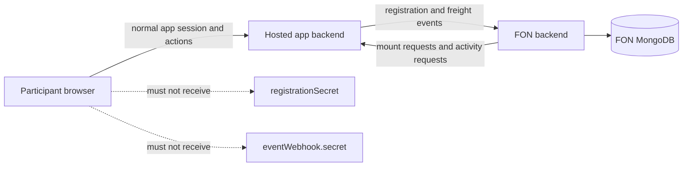
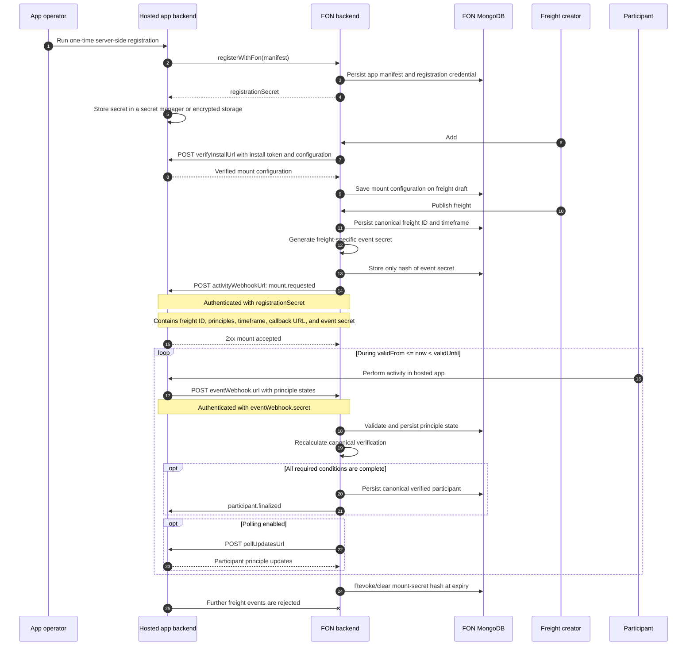

# FON Mount Flow

This document defines how a hosted app registers with FON, how a creator mounts
that app on a freight, and how events are exchanged during the freight's active
window.

## Trust Boundary

Registration and webhook credentials are server-side secrets.



`registerWithFon()` must run in one of the following trusted environments:

- the hosted app's backend;
- a one-time deployment or registration script;
- a protected server route;
- a trusted CLI.

It must not run in browser code. The returned registration secret must never be
placed in a `NEXT_PUBLIC_*` variable, browser bundle, local storage, URL, or
client-visible API response.

The SDK enforces this with a browser runtime guard on `registerWithFon()`,
`verifyInstall()`, `sendParticipantUpdate()`, and
`sendParticipantUpdateToUrl()`. Applications must still keep their own server
routes protected and must not copy SDK results containing secrets into public
responses.

The SDK's public types and principle-evaluation helpers may be used wherever
appropriate. Secret-bearing network operations remain server-to-server.

## Credentials

| Credential | Issued by | Scope | Used for | Lifetime |
| --- | --- | --- | --- | --- |
| Registration bootstrap authorization | FON administrator/account system | Initial app registration | Authorize claiming an `appId` | One-time; production mechanism still required |
| `registrationSecret` | FON | One registered app | Authenticate FON-to-app calls and later manifest updates | Until rotated or app registration is revoked |
| Creator install token | Hosted app | Creator/app relationship | Validate that a creator may mount/configure the app | Defined by the hosted app |
| `eventWebhook.secret` | FON | One app mount on one freight | Authenticate app-to-FON freight events | Only the freight's active window |

The current implementation permits the first registration without bootstrap
authorization. Production deployment should add an authenticated FON account,
wallet signature, developer API key, or administrator-issued one-time token.

## Complete Sequence



## 1. App Registration

Registration occurs once for an app, not once per freight and not once per app
restart.

The app sends its complete manifest:

```ts
const manifest = {
  appId: "my-app",
  appName: "My App",
  description: "What the app verifies",
  sdkVersion: "0.1.0",
  appUrl: "https://app.example.com",
  logoUrl: "https://app.example.com/logo.png",
  iconUrl: "https://app.example.com/logo.png",
  verifyInstallUrl: "https://app.example.com/api/verify-install",
  activityWebhookUrl: "https://app.example.com/api/activity",
  pollUpdatesUrl: "https://app.example.com/api/poll",
  syncMode: "both" as const,
  pollIntervalSeconds: 30,
  supportsTimestampQuery: false,
  principles: [
    {
      principleId: "task-completed",
      title: "Task completed",
      description: "The participant completed the app task.",
      supportsTimestampQuery: false,
      paramsSchema: [],
      paramsDefaults: {},
      readableFormat: "Complete the task",
      exampleReadableText: "Complete the task",
    },
  ],
  configSchema: {},
  configDefaults: {},
};
```

The principles are the app's complete capability catalogue. They do not become
freight requirements until a creator selects them while mounting the app.

### Server-side registration example

```ts
// Run on the app backend or in a protected deployment script.
const result = await registerWithFon(process.env.FON_BASE_URL!, manifest);

await secretManager.put(
  "FON_REGISTRATION_SECRET",
  result.registrationSecret,
);
```

Do not log the secret in production. Persist it directly to a secret manager or
encrypted application storage.

FON stores the app's manifest in MongoDB so it can display the app name, logo,
description, and principles in the `#mounted` chooser.

## 2. Registration Response

The first successful registration returns:

```ts
{
  ok: true,
  appId: "my-app",
  appName: "My App",
  principles: [/* normalized principle definitions */],
  registrationSecret: "FON_GENERATED_APP_SECRET",
  logoUrl: "https://app.example.com/logo.png",
  activityWebhookUrl: "https://app.example.com/api/activity",
  pollUpdatesUrl: "https://app.example.com/api/poll",
  syncMode: "both",
  pollIntervalSeconds: 30,
}
```

The hosted app stores `registrationSecret`. FON retains the credential so it can
authenticate outbound app calls. Later manifest changes call
`registerWithFon()` with the existing secret; an unauthenticated attempt to
overwrite an existing `appId` is rejected.

An ordinary restart only reloads the stored credential. It does not register the
app again.

## 3. Creator Mount Verification

When a creator adds `#mounted`, FON loads the registered app catalogue and shows
each app's persisted logo. The creator chooses an app and at least one principle.

FON sends the app's `verifyInstallUrl`:

```ts
{
  appId: "my-app",
  installToken: "CREATOR_PROVIDED_TOKEN",
  selectedPrinciples: [
    {
      principleId: "task-completed",
      params: {},
      required: true,
    },
  ],
  config: {},
  campaign: {
    freightId: null,
    campaignId: null,
    startsAt: "2026-10-02T12:00:00.000Z",
    endsAt: "2026-10-02T13:00:00.000Z",
    timeframeSeconds: 3600,
  },
}
```

This call verifies the creator's token and app configuration. It does not carry
the mount event secret. At this stage a newly created freight may not yet have
its canonical on-chain ID.

## 4. Canonical Mount Request

After publication, FON has the canonical freight ID and chain-derived timeframe.
FON generates a unique mount secret and calls the app's registered
`activityWebhookUrl`:

```http
POST /api/activity
Authorization: Bearer {registrationSecret}
X-FON-Registration-Secret: {registrationSecret}
X-FON-Event-Type: mount.requested
Content-Type: application/json
```

```ts
{
  eventId: "event-id",
  eventType: "mount.requested",
  appId: "my-app",
  mountableInstanceId: "my-app:unique-mount-id",
  occurredAt: "2026-10-02T11:55:00.000Z",
  freight: {
    freightId: "0x...",
    campaignId: "0x...", // current internal compatibility name
    startsAt: "2026-10-02T12:00:00.000Z",
    endsAt: "2026-10-02T13:00:00.000Z",
    timeframeSeconds: 3600,
  },
  selectedPrinciples: [
    {
      principleId: "task-completed",
      params: {},
      required: true,
    },
  ],
  eventWebhook: {
    mountableInstanceId: "my-app:unique-mount-id",
    url: "https://fon.example/api/mountables/apps/my-app%3Aunique-mount-id/updates",
    secret: "FON_GENERATED_MOUNT_SECRET",
    validFrom: "2026-10-02T12:00:00.000Z",
    validUntil: "2026-10-02T13:00:00.000Z",
    timeframeSeconds: 3600,
  },
}
```

`participant` is optional. It is absent for a freight-wide mount and may be
included when the request targets a specific participant.

The hosted app validates the app-level registration secret and stores the mount
context. FON stores only the hash of `eventWebhook.secret` and redacts the secret
from delivery logs.

## 5. Active Freight Window

During `validFrom <= now < validUntil`, the hosted app evaluates only the
principles selected for that mount.

A participant uses the hosted app through its normal frontend and authentication
flow. The hosted app backend, not the participant's browser, reports the result
to FON:

```http
POST {eventWebhook.url}
Authorization: Bearer {eventWebhook.secret}
X-FON-Installation-Secret: {eventWebhook.secret}
Content-Type: application/json
```

```ts
{
  appId: "my-app",
  campaignId: "0x...",
  participantAddress: "ckb1...",
  principleStates: [
    {
      principleId: "task-completed",
      fulfilled: true,
      detail: "Participant completed the task",
      updatedAt: "2026-10-02T12:15:00.000Z",
    },
  ],
  effectiveAt: "2026-10-02T12:15:00.000Z",
  sourceUpdatedAt: "2026-10-02T12:15:00.000Z",
  statusMessage: "Task completed",
}
```

FON validates the secret, mounted instance, freight, app, timeframe, timestamps,
and principle IDs before persisting the update.

Depending on `syncMode`, FON can also:

- send `participant.updated` and `participant.finalized` events to
  `activityWebhookUrl`, authenticated with `registrationSecret`;
- poll `pollUpdatesUrl` during the active window, authenticated with
  `registrationSecret`.

## 6. Canonical Participant Finalization

A participant is canonically verified only when all applicable conditions pass:

- base freight participation is valid;
- required form conditions are satisfied;
- every required principle from every mounted app is fulfilled.

Optional principles do not block finalization. When verification changes from
pending to verified, FON persists the canonical result and can send
`participant.finalized` to mounted apps.

## 7. Expiry and Revocation

At or after `validUntil`:

- the hosted app should stop sending freight events;
- FON rejects further events for that mount;
- FON stops outbound activity evaluation and polling for that mount;
- the poll worker removes the persisted mount-secret hash and records revocation.

The app-level `registrationSecret` does not expire with a freight because the app
may be mounted on other freights. Only that freight's `eventWebhook.secret`
expires.

## Localhost Development

Localhost works when FON and the hosted app run on the same machine:

```text
FON:        http://localhost:3000
Hosted app: http://localhost:3001
```

It does not work across independently hosted servers because each server's
`localhost` refers to itself. Use public HTTPS deployment URLs or a secure tunnel
for remote integration testing.
